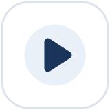
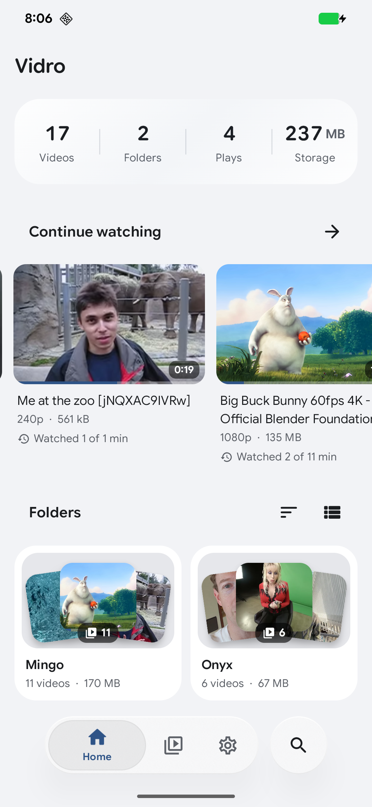
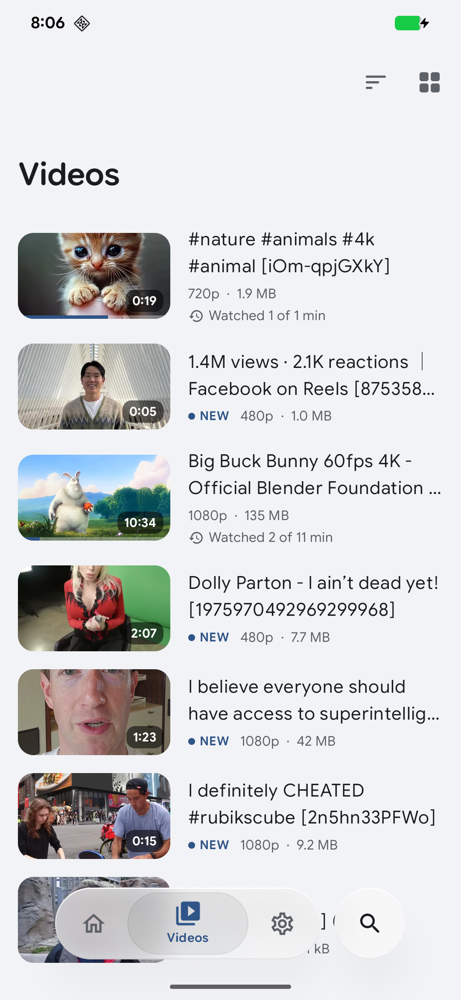
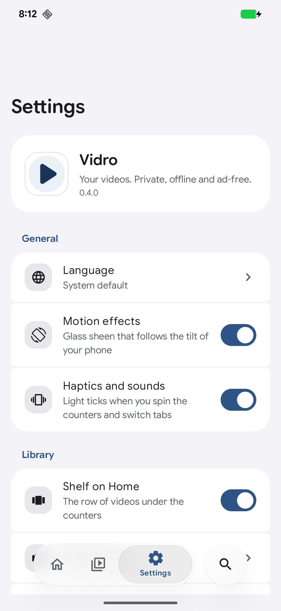
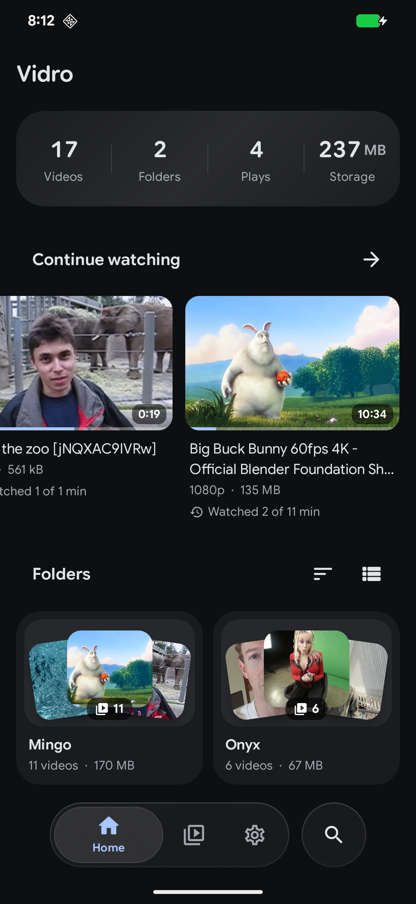
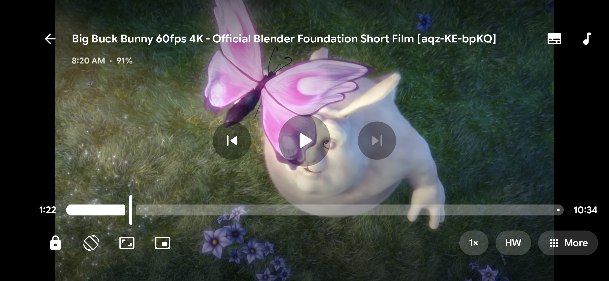
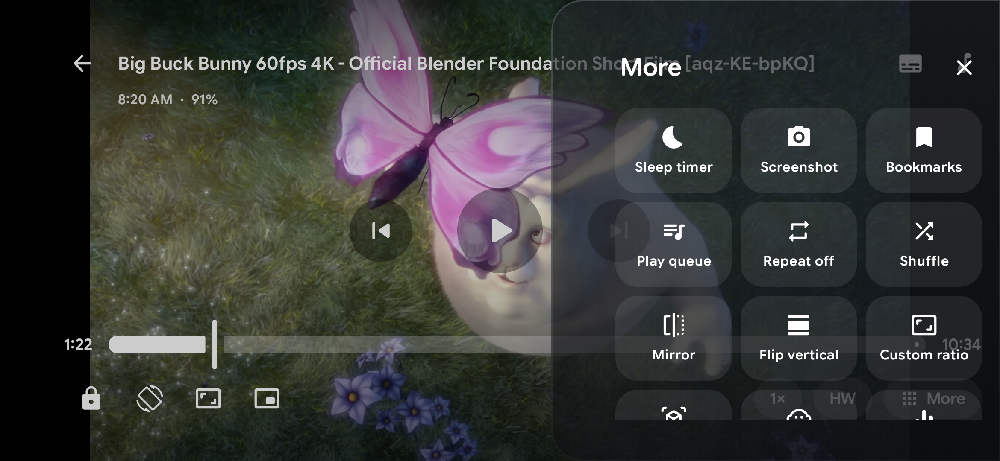
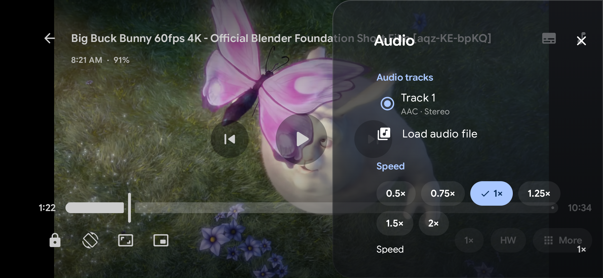

<div align="center">



# Vidro

**A fast, private video player for Android.**<br>
Offline by design. No ads, no tracking, no accounts.

[](https://github.com/sheed-x/Vidro/releases/latest)
[](https://github.com/sheed-x/Vidro/releases)


[**Download the latest release**](https://github.com/sheed-x/Vidro/releases/latest)

</div>

<p align="center">
  
  
  
  
</p>

<p align="center">
  
</p>

<p align="center">
  
  
</p>

## Features

### Playback
- **170+ formats:** MKV, MP4, AVI, WMV, RMVB, FLV, WebM, TS, MOV and more, powered by mpv and FFmpeg
- **Hardware and software decoding:** H.264, HEVC, VP9 and AV1 up to 4K, with automatic fallback
- **Gestures:** seek, brightness, volume, pinch to zoom, double tap to skip, hold for 2× speed
- **Picture-in-picture and background play,** with media controls in the notification
- **Tools:** sleep timer, screenshots, bookmarks, play queue, repeat and shuffle, mirror and flip, custom aspect ratios

### Subtitles and audio
- SRT, ASS/SSA, VTT, SUB, SMI and embedded tracks, two subtitles at once
- Sync, encoding and style controls
- Equalizer and effects, boost to 200%, A/V sync, track switching, external audio files

### Library
- Folders and all-videos views, list or grid, natural sorting and search
- Resume points, continue watching, watch time on every video
- Hide folders and skip short clips
- Light and dark themes that follow the system

## Download

Grab an APK from the [latest release](https://github.com/sheed-x/Vidro/releases/latest):

| File | For |
| --- | --- |
| `Vidro-<version>-arm64-v8a.apk` | Almost every phone from the last few years. **Pick this one if unsure.** |
| `Vidro-<version>-armeabi-v7a.apk` | Older 32-bit phones |
| `Vidro-<version>-x86_64.apk` | Emulators and Chromebooks |
| `Vidro-<version>-universal.apk` | Any device (larger download) |

Checksums are in `SHA256SUMS.txt`. Once installed, Vidro can tell you about new releases and update itself.

## Privacy

Vidro reads your videos locally and never uploads anything. Its only network use is an optional
check for new releases of this repository, which you can turn off in **Settings → About**.

## Requirements

Android 7.0 (API 24) or newer. Picture-in-picture needs Android 8.0+.

## Building

```bash
./gradlew assembleDebug
```

Release builds read signing details from a local `keystore.properties` (not part of the repository).

## Licenses

Vidro uses [mpv](https://mpv.io) and [FFmpeg](https://ffmpeg.org) (LGPL 2.1+) through
[libmpv-android](https://github.com/jarnedemeulemeester/libmpv-android) (MIT), Jetpack Compose
and AndroidX (Apache 2.0), Coil and Haze (Apache 2.0), and the Google Sans Flex font (SIL OFL 1.1).
The full list is in the app under **Settings → About → Open-source licenses**.

<div align="center"><sub>Made by <a href="https://github.com/sheed-x">sheed-x</a></sub></div>
